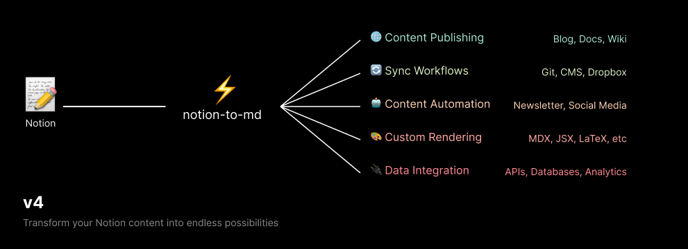

<h1 align="center">
  <br>
  
  <br>
  <b>Notion-to-MD v4</b>
  <br>
  <sub><sup><b>Convert Notion to Markdown & Beyond</b></sup></sub>
  <br>
</h1>

<p align="center">
Turn Notion pages and databases into Markdown, MDX or HTML. Write once in Notion, publish anywhere.
</p>

<p align="center">


</p>

> **v4 is in beta.** v3 stays on `master` and only gets urgent fixes. Moving from v3? See [Migrating from v3](#migrating-from-v3).

## Install

```bash
npm install notion-to-md @notionhq/client
```

Requires Node.js 22+ and `@notionhq/client` v5.

## Quick start

```ts
import { Client } from '@notionhq/client';
import { notionToMd, notion } from 'notion-to-md';
import { markdown } from 'notion-to-md/markdown';

const n2m = notionToMd({
  source: notion(new Client({ auth: process.env.NOTION_TOKEN })),
  renderer: markdown(),
});

const page = await n2m.convert('https://www.notion.so/My-Page-1234...'); // or a page id
console.log(page.content);
```

`convert()` returns a page object:

| Field        | What                                                          |
| ------------ | ------------------------------------------------------------- |
| `content`    | The converted output                                          |
| `title`      | Page title                                                    |
| `properties` | Page properties as plain values (dates, tags, numbers, files) |
| `assets`     | Every file the page uses, with its final URL                  |
| `links`      | Every link to another Notion page                             |
| `warnings`   | Anything that could not be converted (nothing is logged)      |
| `tree`       | The document tree, for your own processing                    |

## Output formats

```ts
import { markdown } from 'notion-to-md/markdown'; // GitHub Flavored Markdown
import { mdx } from 'notion-to-md/mdx'; // MDX that always compiles
import { html } from 'notion-to-md/html'; // HTML fragment
```

- `markdown({ escape: true })` escapes characters like `*` and `_` so Notion text renders exactly as typed. It is off by default, so Markdown typed in Notion stays Markdown.
- MDX sites need `remark-gfm` for tables and task lists, and `remark-math` for equations.

## A blog from a Notion database

```ts
import { notionToMd, notion } from 'notion-to-md';
import { mdx } from 'notion-to-md/mdx';
import { frontmatter, pageLinks } from 'notion-to-md/plugins';
import { downloadMedia, writeFile } from 'notion-to-md/node';

const blog = notionToMd({
  source: notion(client),
  renderer: mdx(),
  plugins: [
    // Notion file links expire after an hour; save them with your site.
    downloadMedia({ dir: './public/images', publicPath: '/images' }),
    // Links between posts point to your site instead of Notion.
    pageLinks((link, { site }) => {
      const slug = site.get(link.pageId)?.properties.Slug;
      return typeof slug === 'string' ? `/blog/${slug}` : undefined;
    }),
    frontmatter({ rename: { Name: 'title' } }),
  ],
});

for await (const post of blog.pages(databaseId)) {
  await writeFile(post, `content/blog/${post.properties.Slug as string}.mdx`);
}
```

`pages()` lists every page in the database first, so links between pages resolve in a single run. It accepts a Notion `filter` and `sorts` as the second argument.

## Plugins

| Plugin                                      | From                    | Does                                                     |
| ------------------------------------------- | ----------------------- | -------------------------------------------------------- |
| `pageLinks((link, context) => url)`         | `notion-to-md/plugins`  | Rewrites links to Notion pages, including block anchors  |
| `media((asset, context) => url)`            | `notion-to-md/plugins`  | Sets the URL of every file, e.g. after uploading it      |
| `frontmatter({ include, exclude, rename })` | `notion-to-md/plugins`  | Adds properties as YAML frontmatter                      |
| `downloadMedia({ dir, publicPath })`        | `notion-to-md/node`     | Saves files to disk; unchanged files are not downloaded again |

Write your own with any of these hooks:

```ts
const plugin = {
  name: 'my-plugin',
  transform(tree, context) {}, // edit the tree before rendering
  resolveAsset(asset, context) {}, // return a URL for a file
  resolveLink(link, context) {}, // return a URL for a page link
  result(page, context) {}, // change the finished page
};
```

## Custom output

Every renderer takes `handlers`, one per node type. A handler replaces that node's output everywhere, including inside lists, toggles and callouts.

```ts
markdown({
  handlers: {
    callout: (node, { content, children }) =>
      `:::note ${node.icon ?? ''}\n${content()}\n\n${children()}\n:::`,
  },
});
```

Handlers get `content()` (the node's text), `children()` (its nested blocks) and `fallback()` (the built-in output, to wrap it).

## Caching and offline use

```ts
import { cached, fromBlocks } from 'notion-to-md';
import { fileCache } from 'notion-to-md/node';

// Reuse blocks until a page is edited.
const source = cached(notion(client), fileCache('.cache/notion'));

// Convert blocks you already have, without calling Notion.
const offline = fromBlocks({ blocks, page });
```

`notion(client, { concurrency: 3 })` limits requests in flight. Rate-limit retries are handled by the Notion client.

## Migrating from v3

| v3                                          | v4                                                         |
| ------------------------------------------- | ---------------------------------------------------------- |
| `new NotionToMarkdown({ notionClient })`    | `notionToMd({ source: notion(client), renderer: markdown() })` |
| `pageToMarkdown(id)` + `toMarkdownString()` | `(await convert(id)).content`                              |
| `setCustomTransformer(type, fn)`            | `markdown({ handlers: { [type]: fn } })`                   |
| `config.escapeMarkdown`                     | `markdown({ escape: true })`                               |
| `config.separateChildPage`                  | Not yet in v4; child pages are written as links            |

## Contributing

1. Fork and clone the repository.
2. `npm install`
3. Make your change with tests.
4. `npm run check` runs everything CI runs: types, lint, formatting, tests, build and package checks.
5. Open a pull request.

See the [Contribution Guide](CONTRIBUTING.md), the [open issues](https://github.com/souvikinator/notion-to-md/issues), or start a [discussion](https://github.com/souvikinator/notion-to-md/discussions).
